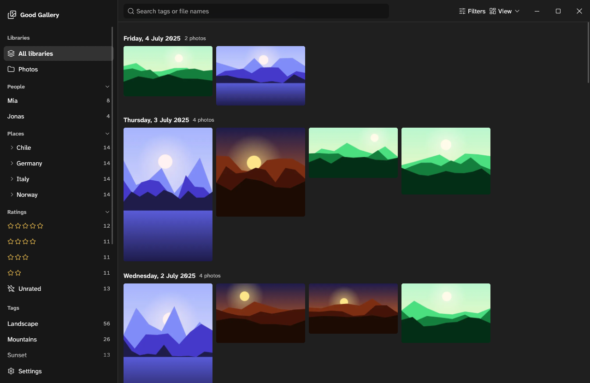
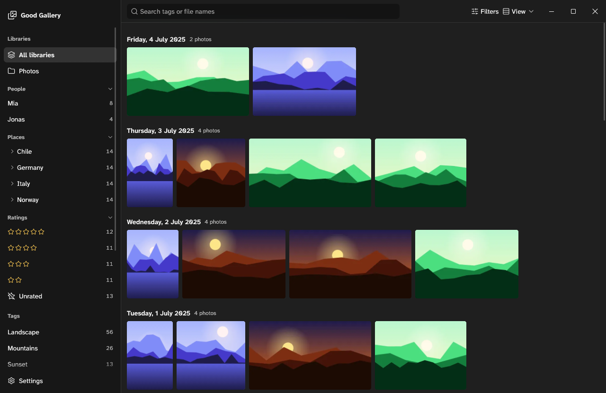
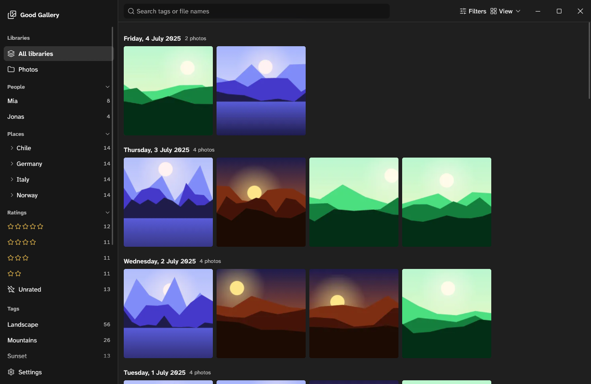
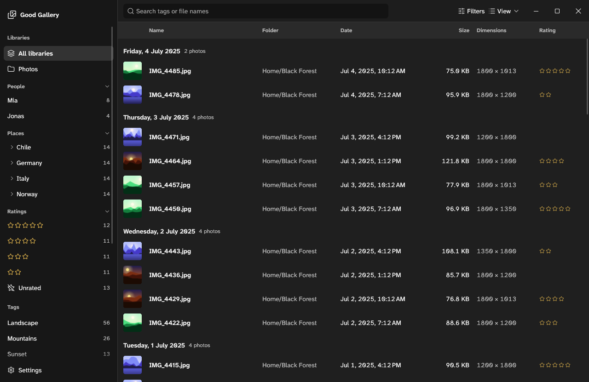
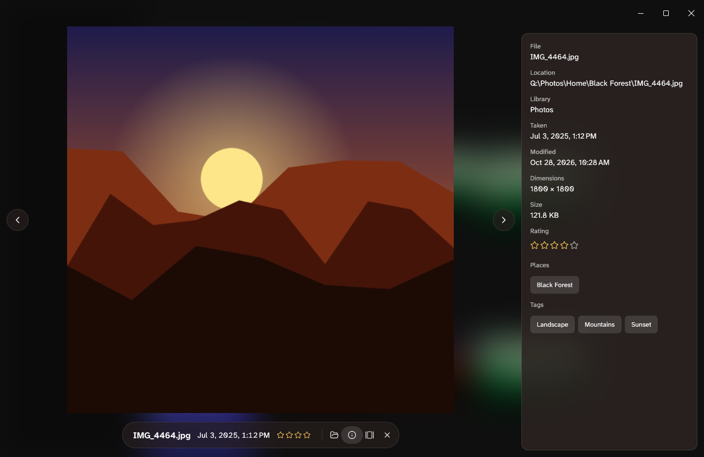

# Good Gallery

A desktop gallery for large photo and video libraries (50k–500k files). Media appear in a virtualized masonry, justified, grid or list view. Libraries on network shares are supported, and thumbnails are cached locally. Search uses the tags that are already embedded in your files.

Built in Rust with eframe / egui on wgpu.

## Features

- **Views:** Masonry (columns), Justified (rows of equal height), Grid (square tiles) and List (details). All are virtualized, so they stay fast at any library size. Media are grouped by day, with the date and the number of photos and videos above each day. Switch views, zoom, sort and grouping under _View_, or zoom with Ctrl + mouse wheel.
- **Network shares:** libraries can live on `\\server\share`. Thumbnails (WebP and ThumbHash placeholders) are cached locally, and the cached index stays browsable while a share is offline.
- **Change detection:** a file watcher picks up changes, plus periodic quick scans. Manual rescans are also possible.
- **Search:** combine tags (include or exclude, hierarchical), file name text and folder; media type, date range and rating are under _Filters_. Sort by date taken, date modified, name, path or size.
- **Sidebar:** libraries with a folder tree, People and Places (from keyword hierarchies and face regions), ratings and popular tags.
- **Viewer:** the photo floats over the blurred window, with controls that step aside while you look. Keyboard navigation, an optional filmstrip to jump through the gallery, zoom and pan, video playback, a metadata panel and "Show in Explorer".
- **Look:** dark, neutral chrome so only your photos bring color; the toolbar and menus are frosted glass over the gallery.
- **Read-only:** tags and ratings come from EXIF / IPTC / XMP and `.xmp` sidecars. Files are never modified.

| Justified                                                             | Grid                                                     |
| --------------------------------------------------------------------- | -------------------------------------------------------- |
|                      |                   |
| **List**                                                              | **Viewer**                                               |
|  |  |

Supported formats: JPEG, PNG, WebP, GIF and AVIF images, plus videos (MP4, MOV, MKV, WebM and more, with poster-frame thumbnails).

## Install

Download from the [releases](https://github.com/Flayms/Good-Gallery/releases) (Windows 10 or 11, 64-bit):

- **`good-gallery-<version>-windows-x64-setup.exe`:** installs for your user (no admin rights), into a folder you can change, with a Start menu shortcut. Uninstall it under _Settings → Apps_.
- **`good-gallery-<version>-windows-x64-portable.zip`:** extract anywhere and run `good-gallery.exe`.

exiftool, ffmpeg and libmpv come with both. The downloads aren't code-signed yet, so Windows SmartScreen may warn: choose _More info_ → _Run anyway_, or unblock the zip (_Properties_ → _Unblock_) before extracting.

Add a library folder under **Settings**. The index, settings, thumbnails and logs live in `%APPDATA%\good-gallery`. Updates keep using it, so nothing is indexed twice. Uninstalling keeps that folder.

### Linux

**`good-gallery-<version>-linux-x64.tar.gz`** (x86-64, X11 or Wayland) uses your distribution's exiftool, ffmpeg and libmpv. Install them first, e.g. on Ubuntu or Debian `sudo apt install libimage-exiftool-perl ffmpeg libmpv2`. Extract the archive and run `./good-gallery`, or `./install.sh` to install it for your user with an app menu entry (`./install.sh --uninstall` removes it). The data folder is `~/.local/share/good-gallery`.

### In the browser

Try it without installing at **[flayms.github.io/Good-Gallery](https://flayms.github.io/Good-Gallery/)**: pick a folder of photos and videos, and the same gallery, search, sidebar and viewer run in the page. There is no server. The index and thumbnails stay in your browser's storage, and nothing leaves your computer (the page's content security policy forbids it any other connection). It works in current Chrome, Edge, Firefox and Safari on a computer. Chrome and Edge remember the folder between visits (after one confirmation); in Firefox and Safari you pick it again to view originals or rescan. The browser version reads what the browser can show (JPEG, PNG, WebP, GIF, AVIF; MP4, WebM and, where the browser plays it, MOV) and is meant for libraries up to about 20,000 files; network shares, watchers and scheduled checks are desktop only.

## Development

Requirements: Rust (pinned in `rust-toolchain.toml`, installed through rustup) and, on Windows, the MSVC C++ build tools with the Windows SDK. On Linux (Ubuntu): `sudo apt install build-essential pkg-config libimage-exiftool-perl ffmpeg libmpv2 mesa-vulkan-drivers` (the helpers come from the system there; `mesa-vulkan-drivers` gives the snapshot tests a software GPU, `xvfb` lets `--screenshot` run without a display). Indexing needs exiftool, thumbnails of videos ffmpeg, playback libmpv: run `./packaging/fetch-helpers.ps1` once and point `GOOD_GALLERY_EXIFTOOL`, `GOOD_GALLERY_FFMPEG` and `GOOD_GALLERY_MPV` at the files in `target/helpers/`, or put the programs on `PATH`. The browser version needs the `wasm32-unknown-unknown` target (installed through `rust-toolchain.toml`), clang (compiles SQLite for wasm), [Trunk](https://trunkrs.dev) (`cargo install --locked trunk`) and, for its tests, Node.js (`npm`; on Linux Playwright's Chromium needs `sudo npx playwright install-deps chromium` once). Releases need git-cliff, the version CI uses: `cargo install --locked git-cliff@2.14.2` (or point `GIT_CLIFF` at it). Builds other than the packaged app (`cargo xtask dist`) keep their data in `%APPDATA%\good-gallery-rust` (Linux: `~/.local/share/good-gallery-rust`), so development never touches the real index.

| Command                             | Purpose                                                                                                        |
| ----------------------------------- | -------------------------------------------------------------------------------------------------------------- |
| `cargo run -p app`                  | Run the app (`-- --data-dir <folder>` for another data folder)                                                 |
| `cargo test --workspace`            | All tests, including the UI snapshot tests                                                                     |
| `cargo clippy --workspace --all-targets -- -D warnings` | Lint                                                                                       |
| `cargo fmt --all`                   | Format                                                                                                         |
| `cargo xtask check-specs`           | Check that specs and tests reference each other                                                                |
| `cargo xtask screenshots`           | Render the README screenshots into `docs/screenshots/` from a generated demo library (needs exiftool, ffmpeg)  |
| `cargo xtask dist`                  | Build the installer and the portable zip into `target/dist/` (needs the helpers and NSIS); on Linux the `.tar.gz` |
| `cargo xtask release`               | Cut a release: bump the version, update `CHANGELOG.md`, tag and push (`--dry-run` previews; needs git-cliff)   |
| `cargo xtask web`                   | Build the browser version into `target/web/` (serve it locally with `node web/tests/serve.mjs`)                 |
| `cargo xtask web-test`              | Build the browser version and run its end-to-end tests in Chromium (`--update-snapshots` after UI changes)      |

CI ([.github/workflows/ci.yml](.github/workflows/ci.yml)) checks formatting, clippy, the specs and all tests on pull requests and on pushes to `main`, on Windows and Linux, and builds and tests the browser version.

### Releases

Commit messages follow [Conventional Commits](https://www.conventionalcommits.org) (`feat: …`, `fix(viewer): …`, `feat!: …` for breaking changes). On an up-to-date, clean `main`, run `cargo xtask release`. It derives the next version from the commits since the last tag (breaking → major, or minor before 1.0; `feat` → minor; else patch), shows the release notes and asks before it sets the version in `Cargo.toml`, commits it with `CHANGELOG.md`, tags `vX.Y.Z` and pushes. Pass `major`, `minor`, `patch` or a version like `1.2.3` to override, `--yes` to skip the question. The pushed tag starts the [release workflow](.github/workflows/release.yml): it runs the checks, builds the installer and the portable zip, smoke-tests the installed app, publishes the GitHub release and deploys the browser version to GitHub Pages.

- [docs/architecture.md](docs/architecture.md): architecture and decisions
- [docs/glossary.md](docs/glossary.md): domain terms
- [docs/specs/](docs/specs/): feature specs and their plans
- [Issues](https://github.com/Flayms/Good-Gallery/issues): upcoming features, bugs and tasks
- [AGENTS.md](AGENTS.md): working guidelines for coding agents

## License

[GPL-3.0](LICENSE). The bundled ffmpeg and libmpv builds are GPL as well; see `packaging/windows/THIRD-PARTY-NOTICES.txt`.
