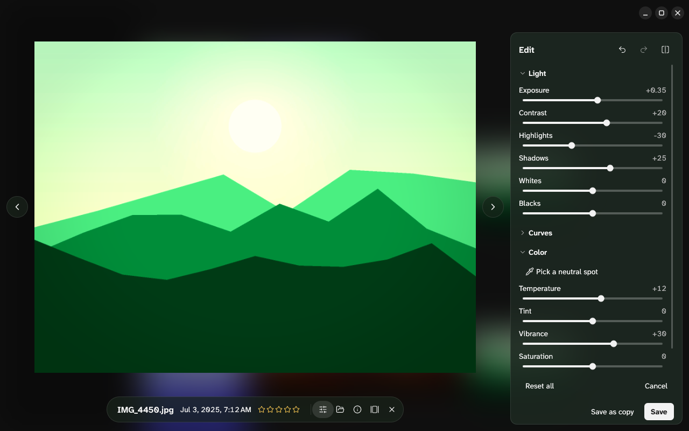

# Good Gallery

A fast desktop gallery for large photo and video libraries, from a few thousand files to half a million, on local disks or network shares. It finds photos by the tags, ratings and dates already in your files, and lets you touch them up without opening another program.

Runs on Windows and Linux. To try it without installing, open the [web version](https://flayms.github.io/Good-Gallery/): your photos stay on your computer.

Written in Rust (egui on wgpu).


## Features

- **Four views:** Masonry, Justified, Grid and List, grouped by day. Scrolling stays smooth with hundreds of thousands of items.
- **Libraries anywhere:** add local folders or network shares (`\\server\share`). Thumbnails are cached on your computer, so an offline share stays browsable.
- **Always up to date:** changes on disk are picked up as they happen, with periodic checks for anything missed.
- **Search by what's in your files:** tags from EXIF, IPTC, XMP and `.xmp` sidecars (Lightroom, digiKam, darktable and others), including hierarchies like `Places|Italy|Rome` and face regions as _People_. Filter by file name, folder, date, rating and type, and sort by date, name, path or size.
- **Viewer:** step through the gallery, zoom and pan, play videos, see a photo's details and a filmstrip of the gallery.
- **Editing:** exposure, brightness, contrast, highlights, shadows, whites and blacks; tone curves over a histogram; white balance, vibrance and saturation; grain and vignette. The subject and the background, found automatically, can each get their own light and color. Save as a copy, or over the original, which is kept so you can revert. Edits stay editable, and metadata and color profiles are kept.
- **Light or dark,** following your system.

Good Gallery doesn't write tags or ratings. It only writes files when you save or revert an edit.

| Justified                                                   | Grid                                                                     |
| ----------------------------------------------------------- | ------------------------------------------------------------------------ |
|            |                                   |
| **List**                                                    | **Viewer**                                                               |
|                      |  |
| **Editing**                                                 |                                                                          |
|  |                                                                          |

**Formats:** JPEG, PNG, WebP, GIF and AVIF photos; MP4, M4V, MOV, WebM and MKV videos. JPEG, PNG and WebP photos can be edited.

## Install

### Windows

Download from the [releases](https://github.com/Flayms/Good-Gallery/releases) (Windows 10 or 11, 64-bit):

- **`good-gallery-<version>-windows-x64-setup.exe`** installs for your user, without admin rights.
- **`good-gallery-<version>-windows-x64-portable.zip`** runs from wherever you extract it.

Both include exiftool, ffmpeg and libmpv. The downloads aren't code-signed yet, so SmartScreen may warn: choose _More info_ → _Run anyway_ (for the zip: _Properties_ → _Unblock_ before extracting).

Your index, settings and thumbnails live in `%APPDATA%\good-gallery`. Updates reuse it, and uninstalling leaves it in place.

### Linux

Download **`good-gallery-<version>-linux-x64.tar.gz`** (x86-64, X11 or Wayland). It uses your distribution's helpers; on Ubuntu or Debian:

```sh
sudo apt install libimage-exiftool-perl ffmpeg libmpv2
```

Extract the archive and run `./good-gallery`, or `./install.sh` to add it to your app menu (`./install.sh --uninstall` removes it). Data lives in `~/.local/share/good-gallery`.

### In the browser

Try it at **[flayms.github.io/Good-Gallery](https://flayms.github.io/Good-Gallery/)** without installing anything. Pick a folder and browse it with the same gallery, search and viewer. Nothing is uploaded: the index and thumbnails stay in your browser. It works in current Chrome, Edge, Firefox and Safari, for folders up to about 20,000 files. Network shares and editing need the desktop app.

## Getting started

Open **Settings**, add a folder as a library and wait for the first indexing to finish. Then:

| Where   | Key                           | Does                                |
| ------- | ----------------------------- | ----------------------------------- |
| Gallery | Ctrl + mouse wheel            | Bigger or smaller tiles             |
| Gallery | Hold the middle mouse button  | Autoscroll                          |
| Gallery | Ctrl + B                      | Hide or show the sidebar            |
| Gallery | Enter, or a click             | Open in the viewer                  |
| Viewer  | ← / →                         | Previous / next                     |
| Viewer  | + / − / 0, mouse wheel, click | Zoom in, out, fit                   |
| Viewer  | I / F                         | Info panel / filmstrip              |
| Viewer  | Space, ↑ / ↓                  | Play or pause a video, volume       |
| Viewer  | E                             | Edit the photo                      |
| Viewer  | Esc                           | Close (while editing: stop editing) |
| Editing | Ctrl + Z / Ctrl + Shift + Z   | Undo / redo                         |
| Editing | Hold \\                       | Compare with the original           |
| Editing | Double-click a slider         | Reset it                            |

Edited photos saved over their original show _Revert to original_ in the info panel.

## Development

### Requirements

- **Rust** through [rustup](https://rustup.rs); `rust-toolchain.toml` pins the version.
- **Windows:** the MSVC build tools with the Windows SDK:

  ```powershell
  winget install Microsoft.VisualStudio.2022.BuildTools --override "--wait --passive --add Microsoft.VisualStudio.Workload.VCTools --includeRecommended"
  ```

  Run `./packaging/fetch-helpers.ps1` once for exiftool, ffmpeg and libmpv (into `target/helpers/`), then point `GOOD_GALLERY_EXIFTOOL`, `GOOD_GALLERY_FFMPEG` and `GOOD_GALLERY_MPV` at them or put them on `PATH`. Tests that need a missing helper skip themselves. The installer needs [NSIS](https://nsis.sourceforge.io) (`winget install NSIS.NSIS`).

- **Linux (Ubuntu):**

  ```sh
  sudo apt install build-essential pkg-config libimage-exiftool-perl ffmpeg libmpv2 mesa-vulkan-drivers xvfb
  ```

  `mesa-vulkan-drivers` gives the snapshot tests a software GPU; `xvfb` runs `--screenshot` without a display.

- **Browser version:** clang, [Trunk](https://trunkrs.dev) (`cargo install --locked trunk`), and Node.js for its tests (on Linux once: `sudo npx playwright install-deps chromium`).
- **Releases:** `cargo install --locked git-cliff@2.14.2`.

Development builds keep their data in `%APPDATA%\good-gallery-rust` (Linux: `~/.local/share/good-gallery-rust`), away from your real index.

### Commands

| Command                                                 | Does                                                                                   |
| ------------------------------------------------------- | -------------------------------------------------------------------------------------- |
| `cargo run -p app`                                      | Run the app (`-- --data-dir <folder>` for another data folder)                         |
| `cargo test --workspace`                                | All tests, including UI snapshots (`UPDATE_SNAPSHOTS=1` rewrites them)                 |
| `cargo clippy --workspace --all-targets -- -D warnings` | Lint                                                                                   |
| `cargo fmt --all`                                       | Format                                                                                 |
| `cargo xtask check-specs`                               | Check that specs and tests reference each other                                        |
| `cargo xtask screenshots`                               | Render the screenshots above from a generated demo library (needs exiftool and ffmpeg) |
| `cargo xtask dist`                                      | Build the installer and portable zip, or on Linux the `.tar.gz`, into `target/dist/`   |
| `cargo xtask web`                                       | Build the browser version into `target/web/`                                           |
| `cargo xtask web-test`                                  | Build the browser version and run its tests in Chromium                                |
| `cargo xtask release`                                   | Cut a release (see below)                                                              |

CI runs formatting, clippy, the spec check and all tests on Windows, Linux and in the browser for every pull request.

### Releases

Commits follow [Conventional Commits](https://www.conventionalcommits.org) (`feat: …`, `fix(viewer): …`, `feat!: …`). On a clean, up-to-date `main`, `cargo xtask release` picks the next version from the commits since the last tag, shows the release notes and, once you confirm, updates `Cargo.toml` and `CHANGELOG.md`, tags and pushes. The tag starts the [release workflow](.github/workflows/release.yml), which builds, smoke-tests and publishes the downloads and deploys the browser version. Pass `major`, `minor`, `patch` or a version to override, `--dry-run` to preview.

### Further reading

- [docs/architecture.md](docs/architecture.md): how it is built, and why
- [docs/design.md](docs/design.md): visual design
- [docs/glossary.md](docs/glossary.md): terms
- [docs/specs/](docs/specs/): feature specs
- [AGENTS.md](AGENTS.md): guidelines for coding agents
- [Issues](https://github.com/Flayms/Good-Gallery/issues): what's next

## License

[GPL-3.0](LICENSE). The bundled ffmpeg and libmpv builds are GPL too; see `packaging/windows/THIRD-PARTY-NOTICES.txt`.
